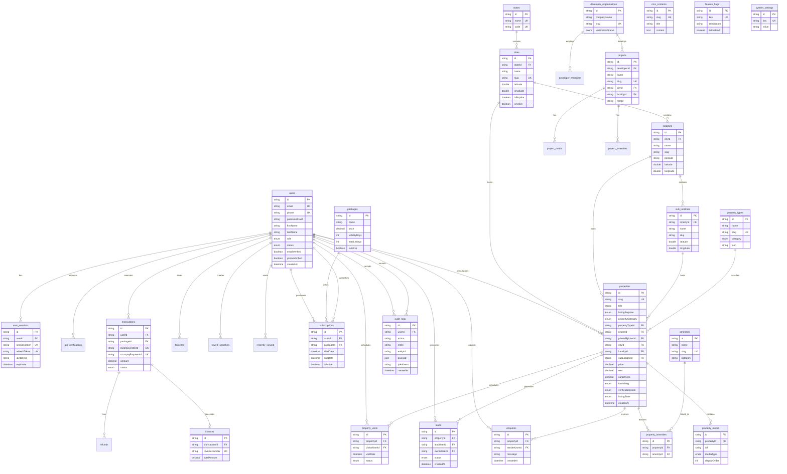

# 📐 Housing Clone — Complete Entity Relationship Diagram (ERD)

This document presents the complete **Mermaid ER Diagram** representing all primary entities, foreign key constraints, and relational cardinalities in the Housing Clone MySQL database.

---

